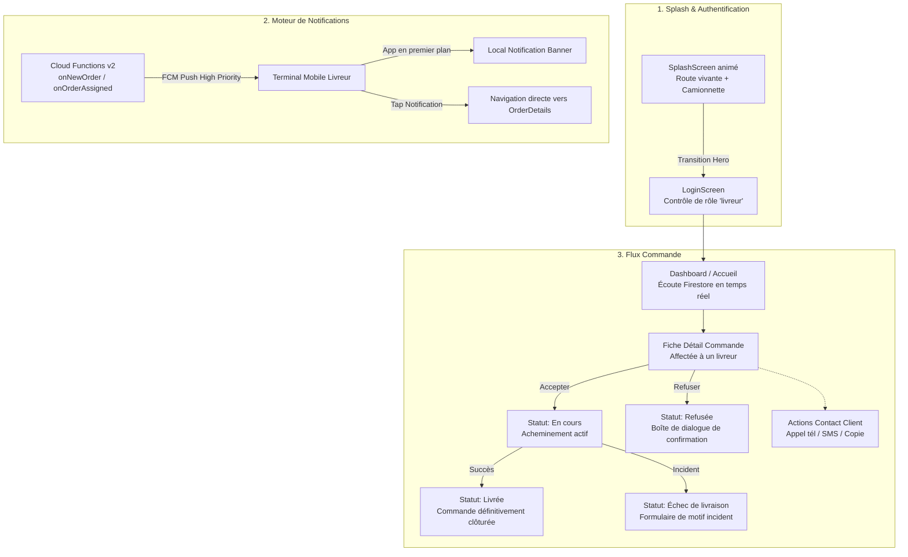
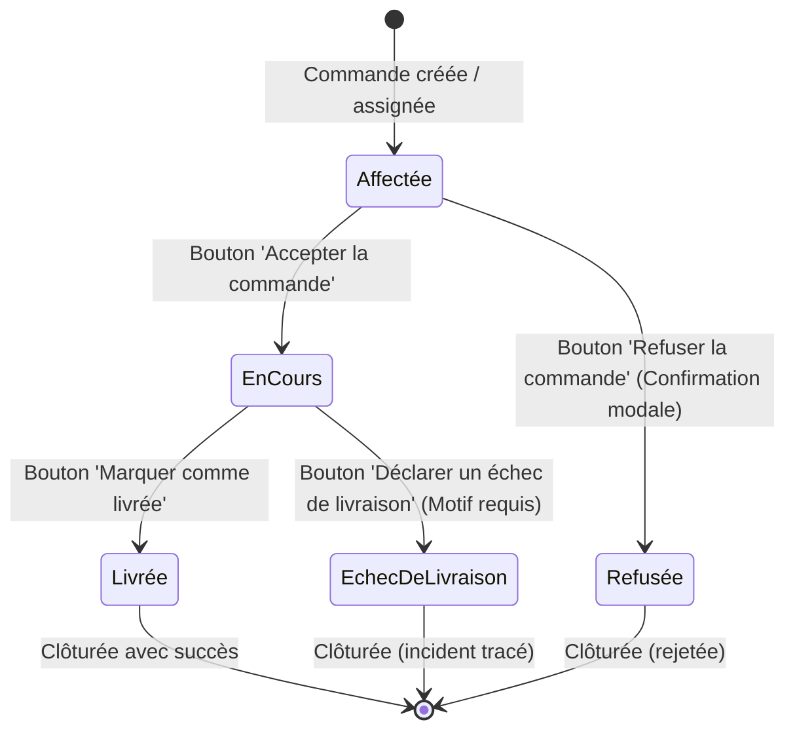

# COMPTE RENDU TECHNIQUE ET FONCTIONNEL
**Application Dokan Delivery — Espace Livreur**

---

## 1. Contexte et Objectifs

Ce compte rendu formalise les récentes évolutions majeures apportées à l'application mobile **Dokan Delivery** (espace dédié aux livreurs), conçue en **Flutter / Dart** et adossée aux services **Firebase** (*Authentication*, *Cloud Firestore*, *Cloud Messaging FCM*, *Cloud Functions v2*).

Ces évolutions portent sur trois axes fondamentaux :
1. **Modification et modernisation du Splash Screen & Authentification** : Immersion visuelle dynamique, animation de route et continuité d'expérience utilisateur (UX).
2. **Ajout du système complet de Notifications Push & Locales** : Intégration de Firebase Cloud Messaging (FCM), Cloud Functions et notifications locales au premier plan avec navigation ciblée vers la commande.
3. **Refonte intégrale du Flux de Commande** : Gestion du cycle de vie d'une livraison (acceptation, acheminement, livraison effective, déclaration d'échec motivé, refus) et intégration de la communication client (appels et SMS natifs).

---

## 2. Synthèse Visuelle des Écrans et Fonctionnalités

---

## 3. Détail des Réalisations par Axe

### Axe 1 : Modification du Splash Screen & Transition Authentification

#### 1.1. Refonte graphique et cinématique (`SplashScreen`)
* **Ambiance visuelle immersive** :
  - Mise en place d'un arrière-plan dégradé dynamique teal (`AppTheme.heroGradient`) sublimé par des cercles luminescents diffus d'arrière-plan.
  - Intégration du composant animé `DeliveryRoadScene` : route animée avec marquage dynamique au sol et véhicule de livraison en circulation.
  - Badge textuel stylisé sous forme de capsule : `"• Espace Livreur"` doté d'une pastille d'activité verte.
  - Slogan de bas de page valorisant l'ADN de la marque : *"Rapidité • Fiabilité • Sécurité"*.
  - Indicateur de chargement rotatif doux (`CircularProgressIndicator`) avec temporisation optimisée de 2600 ms.

#### 1.2. Continuité visuelle Hero et Contrôle d'Accès (`LoginScreen`)
* **Transition fluide Hero** : Le véhicule de livraison anime sa position de l'écran d'accueil jusqu'à la carte d'en-tête de la page de connexion via le tag Hero `'delivery_vehicle_hero_tag'`.
* **Formulaire d'authentification** :
  - Saisie de l'adresse e-mail et du mot de passe avec affichage/masquage sécurisé.
  - Case à cocher *"Rester connecté"*.
* **Contrôle d'accès par rôle strict** :
  - Vérification côté Firestore que le compte connecté dispose bien du rôle `UserRole.deliverer`.
  - En cas de première connexion requérant une mise à jour d'identifiants, redirection automatisée vers `PasswordScreen`.

---

### Axe 2 : Ajout du Système de Notifications en Temps Réel

#### 2.1. Infrastructure Cloud Functions (`functions/src/index.js`)
* **`onNewOrder` (Firestore v2 `onDocumentCreated`)** :
  - Se déclenche dès la création d'une nouvelle commande sur le chemin `orders/{orderId}`.
  - Identifie le livreur affecté (`livreurId`, `driverId`) ainsi que les administrateurs.
  - Envoie un message push FCM prioritaire ciblant le canal Android `"nouvelles_commandes"`.
  - Corps du message formaté : `Commande #<numéro> - Total : <total> <devise>`.
  - Détection et suppression automatique des jetons de notification expirés ou invalides (`FieldValue.arrayRemove`).
* **`onOrderAssigned` (Firestore v2 `onDocumentUpdated`)** :
  - Déclenchée lors de la réattribution ou de la confirmation d'une commande existante à destination d'un livreur avec le titre *"Commande assignée !"*.

#### 2.2. Service Mobile Flutter (`NotificationService`)
* **Canal Android haute priorité** : Canal d'alerte `nouvelles_commandes` avec sonnerie et vibration activées.
* **Cycle de vie du jeton FCM** :
  - Enregistrement immédiat dans le document Firestore du livreur (`fcmTokens` via `FieldValue.arrayUnion`).
  - Écoute proactive du rafraîchissement des tokens via `onTokenRefresh`.
  - Révocation et suppression du token à la déconnexion (`NotificationService.removeToken()`) pour éviter toute fuite de notification entre deux sessions.
* **Notifications au premier plan & arrière-plan** :
  - Prise en charge des réceptions au premier plan via `flutter_local_notifications`.
  - Prise en charge des réceptions en arrière-plan et application fermée grâce au point d'entrée `@pragma('vm:entry-point') firebaseMessagingBackgroundHandler` dans `main.dart`.
* **Navigation directe (Deep-linking applicatif)** :
  - Clic sur une notification locale ou système ➔ extraction de l'identifiant `orderId` ➔ chargement du document commande Firestore ➔ ouverture immédiate de l'écran `OrderDetailsScreen` à travers `notificationNavigatorKey`.

#### 2.3. Configuration Système Android
* **Permissions natives** : Ajout de `POST_NOTIFICATIONS`, `INTERNET` et `VIBRATE` dans `AndroidManifest.xml`.
* **Désucrage de bibliothèque Java** : Activation de `isCoreLibraryDesugaringEnabled = true` avec `desugar_jdk_libs:2.1.4` dans `android/app/build.gradle.kts` pour la compatibilité Android.
* **Visibilité des paquets (`<queries>`)** : Déclaration des schémas `tel` et `smsto` pour permettre le lancement externe de l'application Téléphone et de l'application Messages.

---

### Axe 3 : Refonte Complète du Flux de Commande

#### 3.1. Prise en charge et affichage sur le Tableau de bord (`DashboardScreen`)
* Écoute en continu via `StreamSubscription` sur la collection Firestore `orders` filtrée par le `livreurId` de l'utilisateur authentifié.
* Affichage instantané des commandes assignées dans la carte **"Commandes en attente"** avec boutons d'action rapide *"Accepter"* et *"Refuser"*.
* Statistiques d'activité calculées dynamiquement pour la journée (total courses, livrées, taux de succès).

#### 3.2. Fiche Détail de la Commande (`OrderDetailsScreen`)
* **Informations client exhaustives** :
  - Identifiant lisible (`displayNumber` / code commande).
  - Nom du client.
  - Adresse de livraison complète (gestion des adresses plates ou imbriquées `deliveryAddress`).
  - Montant total à encaisser en Dinars Tunisiens (TND).
* **Communication client native en 1 clic** :
  - **Appel téléphonique** : Lancement automatique du numéroteur natif avec préremplissage du numéro via `url_launcher` (`tel:<numéro>`).
  - **SMS direct** : Ouverture de la messagerie native (`sms:<numéro>`).
  - **Copie presse-papier** : Copie du numéro avec retour visuel par barre de notification (`SnackBar`).
* **Barre d'état et progression visuelle à 3 étapes** :
  - Étape 1 : **Affectée**
  - Étape 2 : **En cours**
  - Étape 3 : **Livrée**

#### 3.3. Cycle de transition des statuts

1. **Acceptation de la course** :
   - Passage de l'état `confirmed` (`"Affectée à un livreur"`) à `in_progress` (`"En cours"`).
   - Enregistrement de l'horodatage de prise en charge `inProgressAt` dans Firestore.
2. **Finalisation de la livraison** :
   - Clic sur *"Marquer comme livrée"* ➔ passage au statut `delivered` (`"Livrée"`).
   - Horodatage `deliveredAt` et affichage d'une carte de confirmation verte : *"Commande terminée — Cette livraison est définitivement terminée."*
3. **Refus de la commande** :
   - Clic sur *"Refuser la commande"* ➔ ouverture d'une boîte de dialogue modale d'alerte :
     - Titre : *"Refuser cette commande ?"*
     - Texte : *"Cette décision est définitive et la commande sera ajoutée à votre historique."*
     - Actions : *"Annuler"* ou *"Confirmer le refus"*.
   - Si confirmé, passage au statut `refused` (`"Refusée"`).
4. **Déclaration d'un échec de livraison avec traçabilité** :
   - Bouton d'alerte rouge *"Déclarer un échec de livraison"*.
   - Affichage d'une boîte de dialogue modale proposant une liste de motifs prédéfinis :
     - *Client injoignable (ne répond pas)*
     - *Adresse introuvable ou incorrecte*
     - *Client absent du domicile / lieu convenu*
     - *Colis refusé par le client*
     - *Autre motif...* (active un champ de saisie texte libre)
   - Validation ➔ passage au statut `failed` (`"Échec de livraison"`), synchronisation de `failedAt` et de `motifEchec` dans Firestore.
   - Présentation sur l'écran d'un **Rapport d'incident** mettant en exergue le motif précis sélectionné.

---

## 4. Synthèse des Fichiers Modifiés et Ajoutés

| Composant / Fichier | Nature | Description technique |
| :--- | :--- | :--- |
| `lib/screens/splash_screen.dart` | Modifié | Intégration de la scène animée `DeliveryRoadScene`, typographie, gradients et durée d'affichage. |
| `lib/screens/login_screen.dart` | Modifié | Transition Hero du véhicule, intégration du contrôle de rôle `UserRole.deliverer` et refonte visuelle. |
| `lib/services/notification_service.dart` | **Nouveau** | Service centralisé FCM : canaux Android, tokens Firestore, notifications locales et deep-link. |
| `functions/src/index.js` | **Nouveau** | Cloud Functions v2 Firestore triggers (`onNewOrder`, `onOrderAssigned`) avec multicast push. |
| `lib/models/delivery_order.dart` | Modifié | Support de la structure `orders`, gestion des adresses imbriquées, parsing et motifs d'échec. |
| `lib/services/order_service.dart` | Modifié | Synchronisation Firestore temps réel, méthodes `marquerEchecCommande`, `refuseOrder`, `advanceOrderStatus`. |
| `lib/screens/order_details_screen.dart` | Modifié | Ajout des appels téléphoniques et SMS natifs, dialogues de refus et de motif d'échec de livraison. |
| `lib/screens/dashboard_screen.dart` | Modifié | Initialisation de `NotificationService`, écoute directe des nouvelles commandes avec alertes locales. |
| `android/app/src/main/AndroidManifest.xml` | Modifié | Permissions `POST_NOTIFICATIONS`, canaux FCM et requêtes `<queries>` pour `tel` et `smsto`. |
| `android/app/build.gradle.kts` | Modifié | Activation du désucrage Java (`coreLibraryDesugaring`) pour le plugin de notifications locales. |

---

## 5. Conclusion

L'ensemble des objectifs a été atteint avec succès :
- L'interface d'entrée est désormais moderne, animée et en totale harmonie avec l'identité Dokan.
- Le dispositif de notifications en temps réel assure une réactivité optimale du livreur face aux nouvelles assignations.
- Le flux de commande offre une ergonomie fluide, sécurisée et exhaustive, garantissant un suivi rigoureux tant pour les livraisons réussies que pour les incidents opérationnels.
